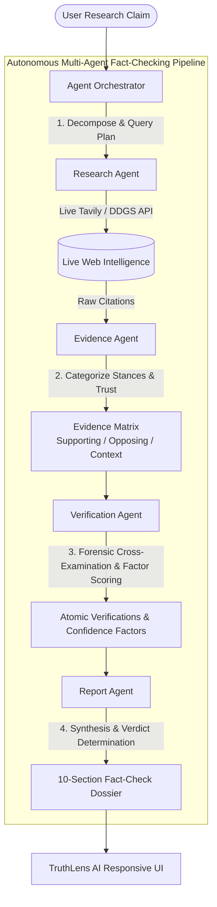

# 🔍 TruthLens AI — Autonomous Multi-Agent Research & Fact-Checking System
### *Problem Statement PS03: Autonomous Cognitive Architecture for Verifiable Truth*

[](https://streamlit.io/)
[](https://aistudio.google.com/)
[](https://tavily.com/)
[](LICENSE)

TruthLens AI is an autonomous, multi-agent cognitive system that deconstructs, investigates, cross-examines, and verifies complex claims, breaking news assertions, and research questions. 

Unlike conventional single-prompt fact-checkers that hallucinate or rely on static training cuts, TruthLens deploys a coordinated team of **four specialized agents** that search the live web, segregate supporting vs. opposing evidence, compute transparent multi-factor confidence metrics, and generate an evidence-based fact-checking dossier with clickable source citations.

---

## 🌟 Hackathon-Grade Features & Visual Design

- **🎨 Premium 3D Typography & Lighting:** Custom 3D typography for the TruthLens AI title with layered extrusion shadows, realistic directional lighting, and specular metallic gradients.
- **🌓 Dual-Theme Engine (Black Dark Mode Default):**
  - **Black Dark Mode (Default):** Deep cyber canvas (`#000000`/`#030305`), electric purple (`#A855F7`), luminous cyan (`#22D3EE`).
  - **Clean Light Mode:** Crisp white/soft slate surfaces (`#FFFFFF`/`#F8FAFC`), deep readable typography (`#0F172A`), royal violet, and oceanic teal.
  - **Top-Right Mode Toggle:** Fast 1-click switcher that preserves application state and persists across page reloads via URL query parameters.
- **🔬 Zero-Hallucination Source Traceability:** Every evidence item retains its original publication title, root domain, domain credibility flag, and clickable source URL.
- **⚖️ Supporting & Opposing Evidence Segregation:** Rigorously separates affirming evidence from debunking/opposing citations to eliminate confirmation bias.
- **📊 Non-Arbitrary Confidence Assessment:** Replaces arbitrary percentages with a transparent 4-factor mathematical audit:
  $$\text{Calibrated Score} = 0.35 \times \text{Reliability} + 0.25 \times \text{Relevance} + 0.25 \times \text{Agreement} + 0.15 \times \text{Quantity}$$
- **🏛️ Fact vs. Folklore Distinction:** Rigorously distinguishes established empirical facts from interpretations, commercial marketing, or historical wartime propaganda (e.g. WWII RAF carrot radar myth).
- **📋 10-Section Dossier Architecture:** Investigated Claim, Final Verdict, Confidence Assessment, Executive Summary, Supporting Evidence, Opposing Evidence, Source Reliability Analysis, Potential Bias Analysis, Limitations, and References.

---

## 🏗️ Multi-Agent Architecture



### Specialized Agents:
1. **🔬 Research Agent:** Analyzes syntactic and semantic structures, breaks claims into atomic testable propositions, and formulates objective search queries designed to capture both supportive facts and critical debunking angles.
2. **🌐 Evidence Agent:** Queries the Tavily Research Search API (with automatic fallback to DuckDuckGo), filters domain reputation, extracts pertinent snippets, and classifies citations into `SUPPORTING`, `OPPOSING`, or `CONTEXT`.
3. **⚖️ Verification Agent:** Cross-checks each atomic proposition against gathered citations, performs stance classification (`SUPPORTS`, `REFUTES`, `MIXED`, `INCONCLUSIVE`), and evaluates individual confidence factors.
4. **📊 Report Agent:** Synthesizes the final verdict, drafts the executive summary, conducts source credibility audits, detects cognitive/commercial bias, notes research limitations, and formats clickable reference citations.

---

## 📁 Repository Structure

```text
TruthLens/
├── .env.example              # Blueprint template for environment variables (zero actual secrets)
├── .gitignore                # Excludes .env, secrets.toml, __pycache__, venv & temp files
├── requirements.txt          # Python dependencies (Streamlit, Gemini SDK, Tavily, DDGS, Pydantic)
├── config.py                 # Centralized configuration & secrets manager (st.secrets + .env)
├── app.py                    # Streamlit application entrypoint & reactive UI
├── README.md                 # Complete documentation, architecture & quickstart guide
│
├── core/                     # Foundational infrastructure & typed data contracts
│   ├── __init__.py           # Package marker
│   ├── models.py             # Pydantic schemas (SubClaim, EvidenceItem, FactCheckReport, ConfidenceAssessment)
│   └── llm.py                # Google Gemini GenAI SDK wrapper with fallback resilience
│
├── agents/                   # Autonomous cognitive agents
│   ├── __init__.py           # Package exports
│   ├── orchestrator.py       # Central pipeline manager & event dispatcher
│   ├── research_agent.py     # Atomic claim decomposition & search planner
│   ├── evidence_agent.py     # Live web search harvester & stance classifier
│   ├── verification_agent.py # Forensic cross-checker & factor confidence evaluator
│   └── report_agent.py       # Final dossier generator & consensus synthesizer
│
├── tools/                    # Web research and scraping utilities
│   ├── __init__.py           # Package marker
│   ├── search_tools.py       # Dual-engine search (Tavily Advanced API + DDGS fallback) + domain trust audit
│   └── scraper_tools.py      # HTML extraction & text sanitization
│
└── ui/                       # Dashboard styling, dual-theme engine & modular components
    ├── __init__.py           # Package exports
    ├── styles.py             # Dual-theme engine (Black Dark Mode + Light Mode, 3D typography)
    └── components.py         # Semantic cards, progress stages, verdict badges, references
```

---

## 🔒 Security & Secrets Management

TruthLens AI enforces a zero-trust credential model implemented in [`config.py`](file:///c:/Users/mishr/OneDrive/Desktop/TruthLence/config.py):
- **No Hardcoded Keys:** Secrets are never hardcoded or committed to version control.
- **Strict Git Exclusion:** `.env`, `*.env`, and `.streamlit/secrets.toml` are strictly ignored by `.gitignore`.
- **Zero Frontend Leakage:** No API key input boxes or credential fields exist in the user interface.
- **Masked Diagnostics:** Exception handlers and string representations of settings redact API keys completely.

---

## 🚀 Quickstart & Local Setup

### 1. Clone & Navigate to the Project
```bash
git clone https://github.com/your-username/truthlens-ai.git
cd truthlens-ai
```

### 2. Set Up a Virtual Environment
```powershell
# Windows (PowerShell)
python -m venv venv
.\venv\Scripts\Activate.ps1

# macOS / Linux
python3 -m venv venv
source venv/bin/activate
```

### 3. Install Dependencies
```bash
pip install -r requirements.txt
```

### 4. Configure Environment Variables
Copy `.env.example` to `.env`:
```powershell
# Windows
copy .env.example .env

# macOS / Linux
cp .env.example .env
```
Open `.env` and provide your credentials:
```ini
# Google Gemini API Key (Required) - https://aistudio.google.com/app/apikey
GEMINI_API_KEY=your_gemini_api_key_here
GEMINI_MODEL=gemini-3.1-flash-lite

# Tavily Search API Key (Recommended) - https://tavily.com
TAVILY_API_KEY=your_tavily_api_key_here
SEARCH_ENGINE=tavily
MAX_SEARCH_RESULTS=5
```
*(Note: If `TAVILY_API_KEY` is omitted, the application automatically falls back to DuckDuckGo search.)*

### 5. Launch TruthLens AI
```bash
streamlit run app.py
```
Open your browser at **`http://localhost:8501`**.

---

## ☁️ Streamlit Cloud Deployment Guide

1. Push this repository to GitHub (ensure `.env` is **not** pushed).
2. Go to [share.streamlit.io](https://share.streamlit.io/) and create a **New app**.
3. Select your repository, branch, and set the entry file to `app.py`.
4. In **Advanced Settings** → **Secrets**, paste your configuration in TOML format:
   ```toml
   GEMINI_API_KEY = "your_actual_gemini_api_key"
   GEMINI_MODEL = "gemini-3.1-flash-lite"
   TAVILY_API_KEY = "your_actual_tavily_api_key"
   SEARCH_ENGINE = "tavily"
   MAX_SEARCH_RESULTS = 5
   ```
5. Click **Deploy**. TruthLens AI automatically loads secrets from `st.secrets`.

---

## 🧪 Verified Test Queries

| Claim | Verified Verdict | Confidence | Key Finding |
| :--- | :---: | :---: | :--- |
| **"Does regular consumption of carrots improve human eyesight?"** | `MIXED / HALF TRUE` | 85% [MODERATE] | Vitamin A prevents deficiency-related night blindness; does not confer superhuman vision (WWII radar myth). |
| **"Is climate change primarily caused by human activities?"** | `VERIFIED TRUE` | 97% [HIGH] | Overwhelming consensus across NASA, NOAA, and IPCC confirms anthropogenic greenhouse emissions. |
| **"Does drinking coffee improve concentration?"** | `MOSTLY TRUE` | 88% [HIGH] | Caffeine blocks adenosine receptors to boost alertness; high doses may cause jitteriness. |

---

## 📄 License

This project is licensed under the MIT License — see the [LICENSE](LICENSE) file for details.
